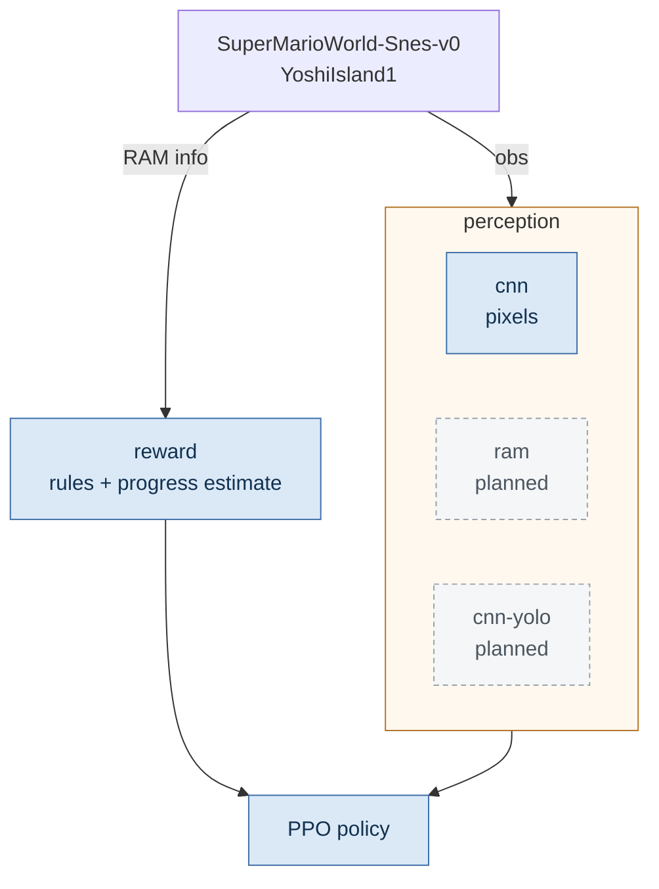
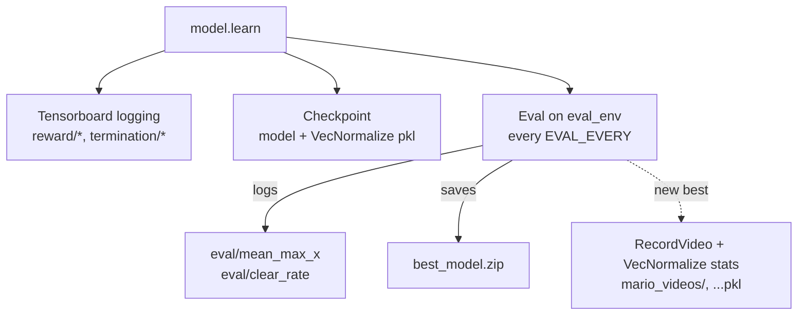

<h1 align="center">DeepMario-SMW</h1>

<p align="center">
  PPO on Super Mario World, with pluggable perception.
</p>

<p align="center">
  <a href="https://github.com/jasonkwh/DeepMario-SMW/actions/workflows/check.yml"></a>
  <a href="LICENSE"></a>
</p>

---

One policy is meant to clear the whole game; `Yoshi's Island 1` is just the stage
it learns first, picked by `STATE_NAME` in `config.py`.

Perception is pluggable (`ENCODER`): `cnn` reads stacked 84x96 grayscale frames,
`ram` and `cnn-yolo` are planned. Everything downstream - reward, wrappers,
evaluation, the training loop - is shared, so the three stay comparable. The
action space is 19 discrete button combinations.

## Install

- Python 3.10+
- `stable-retro==1.0.1`, `stable-baselines3==2.9.0`, `gymnasium==1.3.0`
- A Super Mario World ROM in the repo root as `.sfc` (git-ignored, never committed)
- `ffmpeg` on `PATH` (video recording)

```bash
make install     # pip install + patch game data
make train       # patch data.json, then train.py
make tensorboard
```

`setup.py` patches the installed game `data.json` with the RAM fields the reward
needs, so it runs before every training start.

## Commands

| Command               |                                              |
| --------------------- | -------------------------------------------- |
| `make` / `make train` | Patch game data, then train                  |
| `make bench`          | Emulator and policy throughput               |
| `make check`          | Syntax + import boundary (same as CI)        |
| `make tensorboard`    | Serve `mario_logs/tensorboard/`              |
| `make clean`          | Delete checkpoints, best model, videos, logs |
| `make install`        | Requirements + game data                     |

```bash
make train ENCODER=cnn                     # output paths follow the encoder
make train TB_LOG_NAME=t4-aug              # separate TensorBoard run
make bench ENCODER=cnn N_ENVS=2 BENCH_SECONDS=30   # smaller machines
```

`ram` and `cnn-yolo` raise as soon as the encoder is built, before any
environment starts, until their encoders land.

## Configuration

All knobs live in `config.py`, each with a short comment. `N_ENVS` defaults to
the usable core count (8 on 8 vCPU) and `N_ENVS=6 make train` overrides it for
one run; training, evaluation and benchmarking all read it. `EVAL_N_ENVS` is
separate because evaluation pipelines on top of the training envs. The valid
encoders are the `EncoderType` enum in `encoders/encoder.py`.

`config.py` must stay importable without heavy dependencies: `encoders/__init__.py`
resolves `CnnEncoder` and `build_encoder` lazily, and `make check` fails if
importing `config` pulls in torch.

## Architecture

`ENCODER` picks one perception layer at a time; everything downstream of it is
shared. Reward is independent of perception - it reads the emulator's RAM fields,
not the observation - so the two branches run in parallel. Solid is implemented,
dashed is planned.

Per-env wrappers still apply in a fixed order - `ActionWrapper`, `RewardWrapper`,
the encoder's own observation stack, `TimeLimit`, `Monitor` - and only the reward,
action and time wrappers are shared by every encoder. The two channels are
independent by dependency, not by plumbing: the reward scalar still passes through
the encoder's skip wrapper, which sums it over `FRAME_SKIP` frames.



Callbacks hang off the training loop, not the environment:



The eval branch is the same stack with augmentation off, in `EVAL_N_ENVS` processes.
`RecordVideo` is not part of either stack - `RecordVideoCallback` wraps a throwaway
environment with it when the best model improves.

One observation is `(4, 84, 96)` - grayscale frame plus 3 action planes - and
`VecFrameStack` makes it `(16, 84, 96)`. Action indices in those planes are scaled to
0-255 so the observation stays uint8 and stock `CnnPolicy` needs no custom extractor.

## Encoders

An encoder owns its whole observation pipeline, not just the network:
`build_policy()` returns the policy name and `policy_kwargs`, `wrap_env()` applies
the per-env observation stack, and `wrap_vec_env()` applies the vector-level
wrappers (`VecFrameStack`, `VecTransposeImage`). `encoders/factory.py` maps the
enum to an encoder; unimplemented ones raise instead of silently falling back.

| `ENCODER`  | State       |                                                                                           |
| ---------- | ----------- | ----------------------------------------------------------------------------------------- |
| `cnn`      | implemented | Stock `NatureCNN`: conv 32x8x8/4, 64x4x4/2, 64x3x3/1, flatten, linear 512, then PPO heads |
| `ram`      | planned     | RAM fields (position, sprite slots, tiles) straight to an MLP                             |
| `cnn-yolo` | planned     | Pixel stream plus a detection stream                                                      |

The `cnn` encoder deliberately adds nothing on top of `NatureCNN` - it is the
end-to-end baseline the other two are measured against.

## Reward

Values are pre-normalisation; `VecNormalize` normalises and clips them.

| Rule                       | Value                        |
| -------------------------- | ---------------------------- |
| Level completed            | +100                         |
| Time ran out               | -10                          |
| Lost a life / last life    | -5 / -20                     |
| Coin                       | +1.0                         |
| Other score increase       | +0.5                         |
| Power-up big / cape / fire | +0.1 / +0.2 / +0.2           |
| Lost a power-up            | -0.1                         |
| Star                       | +0.3                         |
| Timer per step             | -0.00025 (doubles below 100) |
| Progress per pixel of x    | +0.1                         |

Rules run in a fixed order: termination rules first, then shaping (see
`wrappers/reward.py`). The first termination rule that triggers ends the episode.

The return is the sum of the rules only. stable-retro's own reward (10x the score
delta, per `scenario.json`) is logged as `reward/base` for diagnostics and is not
part of the return, so score cannot outweigh distance.

Every life lost is logged as `life_lost/x` and `life_lost/lives`, recorded only on
the step it happens (`lives` is `-1` on the last one).

## Evaluation

Stock `EvalCallback` bookkeeping plus two metrics that answer whether the policy
gets further:

- `eval/mean_max_x` - mean furthest x per episode
- `eval/clear_rate` - share of episodes that clear the level

Evaluation samples actions (`EVAL_DETERMINISTIC = False` in `config.py`) so the
episodes are independent: stable-retro resets to the same savestate and ignores
seeds, so a deterministic policy would repeat one trajectory ten times.

The final evaluation prints reward, max_x, clear rate and episode length, and
records them as `final/*`.

## Benchmark

```bash
make bench
python tools/bench_env.py --envs 6 --seconds 60 --no-augment
```

Reports steps/s per env, whether throughput scales with env count, and policy
forward latency on CPU/GPU. `--no-augment` isolates the randomisation cost.

## Outputs

- `mario_checkpoints/mario_ppo_<encoder>_<steps>_steps.zip` + `mario_ppo_<encoder>_vecnormalize_<steps>_steps.pkl`
- `mario_best_model/<encoder>/best_model.zip` + its VecNormalize stats
- `mario_logs/monitor_<encoder>-<rank>.csv`, `monitor_evaluation_<encoder>-<rank>.csv`
- `mario_videos/` - written on every new best model
- `mario_logs/tensorboard/<TB_LOG_NAME>/`

Every path is derived from `RUN_NAME` (`<encoder>-<frame stack>`), so different
encoders and frame stacks never overwrite each other. `RESUME_FROM` picks the checkpoint; with no checkpoint, stale best-model
files are removed first so a fresh run cannot inherit an old best. Reuse
`TB_LOG_NAME` to keep resuming runs in one TensorBoard directory.

## Game data

`setup.py` adds these fields to `data.json`: `x`, `y` (position, drives progress),
`powerup` (00 small, 01 big, 02 cape, 03 fire), `item` (item box), `timer_hundreds`
/ `timer_tens` / `timer_ones`, `level_end_timer` (non-zero once completion starts),
`star_timer`. The `ram` encoder will read the same table.

## Known limitations

- **Episodes always start from the same savestate.** stable-retro restores the
  savestate on reset, RNG included, so every episode opens identically; the eval
  env also runs without augmentation. The only variance comes from stochastic
  action sampling (`EVAL_DETERMINISTIC = False`). With `deterministic=True` the
  `N_EVAL_EPISODES` runs collapse into one sample and `clear_rate` is effectively
  0 or 1. Randomising the start is the real fix and is not implemented.
- **No upward actions.** `UP` combos are commented out, so no swimming up and no
  dismounting Yoshi. Acceptable on this stage, required later.
- **The eval env carries a no-op `VecNormalize`.** Required, because SB3's
  `sync_envs_normalization` asserts matching wrapper stacks.
- **`is_dead` is unverified.** It assumes the lives counter reads -1 on the final
  death frame.
